# Studio Manager – Feature Overview

As of October 23, 2026 (v1.19.0). Screenshots show test data.

## What it is

Studio Manager is a web app that runs the whole day-to-day of a recording studio in one place: clients and bands, projects and songs, sessions, gear, input lists, mixing feedback and the money side. It was built for Scumlight Studio and has been in daily use since October 2026 (current version v1.19.0).

- **One place instead of many:** it replaces spreadsheets, paper session notes, chat threads with the band and a separate invoicing tool.
- **Built from real studio work:** every feature came out of actual sessions, and the first real test led to a full revision round.
- **Bands are part of it, without an account:** a private link per project lets the band enter their gear, listen to mixes and demos, comment and approve.
- **Runs anywhere with a browser:** on the computer in the control room, a tablet or a phone. German and English, dark and light mode.
- **Your own data on your own server:** it runs self-hosted, with nightly backups that can be copied off the server encrypted.

## Start page and everyday use

The start page answers "what's going on today?" at a glance, so you don't have to click through projects in the morning.

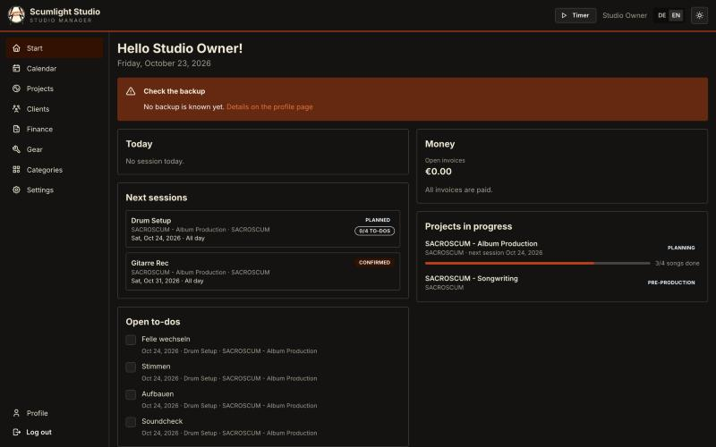

- Today's sessions and the next upcoming ones
- Open to-dos from all sessions, which you can tick off right there
- Unpaid invoices and open quotes
- Projects in progress, with how far each one's songs have come
- "New from clients": comments, approvals and references bands sent through their link
- A warning if the last backup failed

Across the app: clients, bands and projects can be shown as a list or as picture tiles, lists can be searched and filtered, and almost every page can be printed as a clean sheet.

## Clients, bands and projects

Everything hangs off the project: a client books it, one or more of their bands play on it, and all songs, sessions, mixes and invoices belong to it.

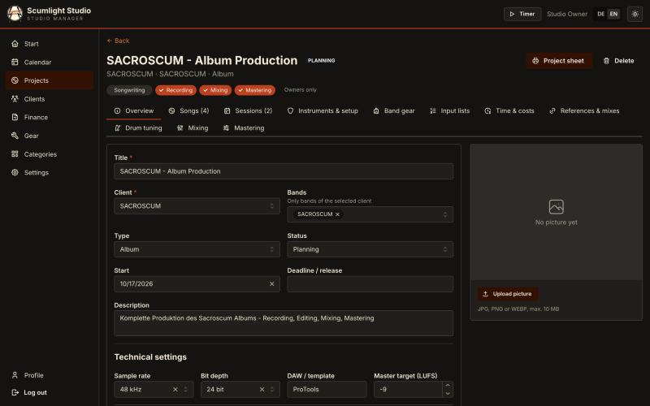

**Clients and bands**

- A client (person, label, management) can have several bands; a project can include several of them, e.g. for a split release.
- Pictures for clients and bands, cover art for projects. If a band has no picture, it shows the client's, and the other way round.

**Projects**

- Type: Album, EP, Single, Split release, Demo or Other.
- Status: Planning → Pre-production → Recording → Editing → Mixing → Mastering → Completed, plus a deadline.
- Scope: Recording, Mixing, Mastering and/or Songwriting. Tabs the project doesn't need are hidden, so a mix-only job stays uncluttered.
- Technical settings: sample rate, bit depth, DAW, target LUFS.
- Separate notes for the recording, mixing and mastering phase.
- References and rough mixes as links.
- A printable project sheet with everything on one page.

## Songs and songwriting

Every song gets its own page that holds everything you need while tracking it.

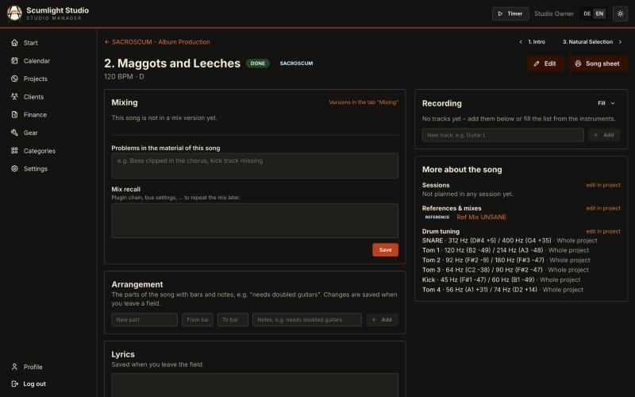

**Song page**

- Band, tuning and tempo; several tempos per song for tempo changes, optionally from a given bar.
- Status from planned through recording, editing, mixing and mastering to done; you can change several songs at once.
- Arrangement: parts like "Verse 1" or "Chorus 2" with bars and notes such as "needs doubled guitars".
- Recording checklist: the song's tracks (drums, guitar L/R, lead vocal, ...) marked open, recorded or edited. It is pre-filled from the project's instruments or copied from another song, and the song list shows each song's progress.
- Lyrics, reference links, drum tunings and the sessions the song was worked on.
- Mix feedback, problems found in the material, and the mix recall (see Mixing).
- A printable song sheet.

**Songwriting** (for your own bands or writing projects)

- Its own tab with song statuses Idea, Writing and Demo.
- Voice memos: upload many at once from the phone, play them, and sort them from an inbox into songs and into parts of the arrangement.
- Demo versions ("Demo 1", "Demo 2", ...) that the band can listen to, comment on and approve through their link.
- A printable songbook: an overview, then every song with arrangement, memos and lyrics on its own page.

## Gear, instruments and setups

The gear inventory knows what you own, and each project's instrument setups record exactly what was used to record what.

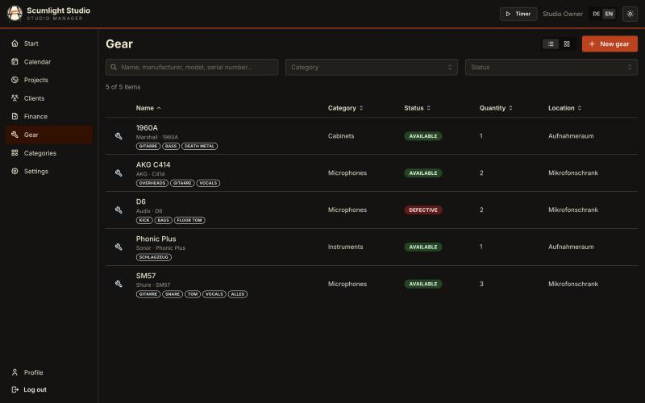

**Gear inventory**

- Every item with category, status (available, defective, in repair, lent out, retired), quantity, serial number, location, purchase data, notes and a photo.
- Editable categories, including software (plugins, virtual instruments).
- "Good for" tags such as "snare top" or "guitar cab", searchable and used for suggestions.
- Each item shows where it is used: "in session today" and which projects use it, with the settings.
- Gear that is used in a setup can't be deleted by accident.

**Instruments and setups per project**

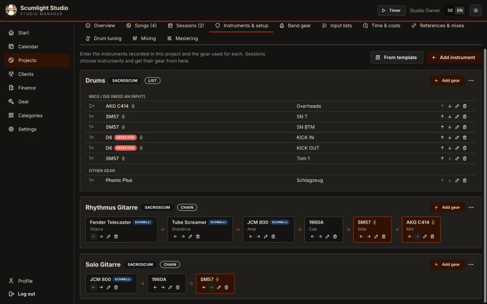

- Each recorded instrument gets its setup: studio gear, the band's own gear or free text, with "used for" and quantity.
- Signal chains for guitar and bass, e.g. Les Paul → Tube Screamer → JCM800 → 1960A → SM57; lists for drums.
- Mics and DIs are marked as "needs an input" and feed the input list automatically.
- Setup templates: save a setup you like and start new instruments from it.
- Drum tuning per drum, entered in Hz (e.g. from a TuneBot) and shown as a note.

**Band gear via link**

- The band enters the gear they bring on a link without a login. You review and accept the entries, so nobody has to type gear lists from a chat message.

## Studio inputs and input lists

Input lists build themselves from the setups, so the patch sheet is ready before the band arrives.

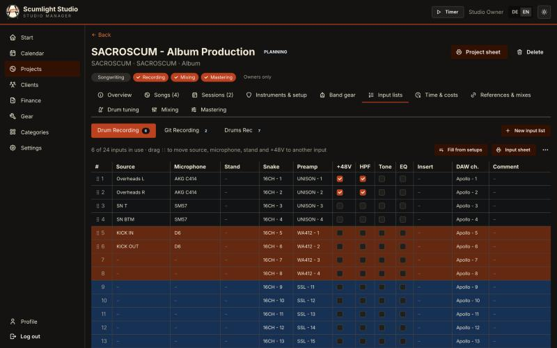

- **Studio I/O, set up once:** snake channels, preamps with a group color, and DAW channels. Several inputs can be created at once with numbering.
- **Several input lists per project** (one tab each, e.g. drums day and vocal day), pre-filled from the mics and DIs in the instrument setups.
- **Per input:** source, microphone, stand, +48V, HPF, tone/EQ, insert and a comment.
- **Stereo pairs:** a pair such as overheads becomes "L" and "R" automatically.
- **Drag and drop:** move a source with its mic, stand and +48V to another input (e.g. the snare to another preamp). The channel settings stay with the channel.
- **Sessions pick their input list**, and the input sheet prints for the live room.

## Sessions and calendar

A session is a studio day (or several) of a project, and it carries its own plan, gear and notes.

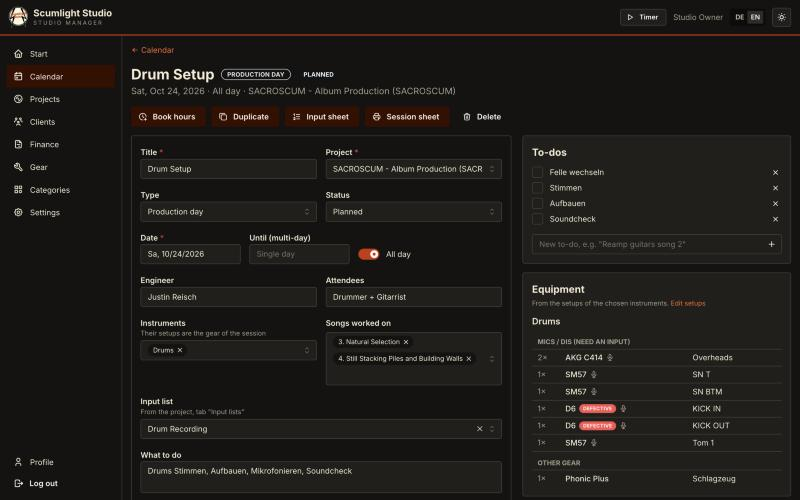

- **Flexible times:** all-day, a time range, or multi-day (e.g. Fri–Sun, 9:00–17:00 daily).
- **Status:** planned, confirmed, completed or cancelled, changeable right in the list.
- **Plan and notes:** a to-do list, the songs worked on, and goals / where we are / next steps for the following session.
- **Gear and inputs:** the session picks its instruments and input list and inherits their gear.
- **Series of days:** duplicate a session to one or many dates, or "copy from" an earlier session when creating a new one.
- **Calendar view:** all upcoming sessions grouped by month, overdue ones on top, done and cancelled ones collapsed.
- **Calendar subscription:** a secret link puts all sessions into your phone or Nextcloud calendar.
- **Printouts:** a session sheet (to-dos, songs, gear to set up, band gear, drum tuning) and a session timetable that gives the band an overview of all planned dates.
- **Book the hours:** when a session is done, its hours go straight into time tracking (see Finance).

## Mixing, mastering and the client link

Mix feedback no longer gets lost in chat threads: every comment is tied to a mix version, a song and a timecode.

**Mixing tab**

- The incoming material, recorded once per project, including problems found in it.
- Mix versions of the project, e.g. "v1" for all songs and "v1.1" for some of them.
- Feedback per song with timecode, grouped by song, from the studio and from the band.
- Revisions counted per song. Revisions beyond what was agreed can be added as a cost item.
- Mix recall on the song page, so you can get back to a mix later.
- Status per mix, up to "Completed" (Abgeschlossen).

**Mastering tab**

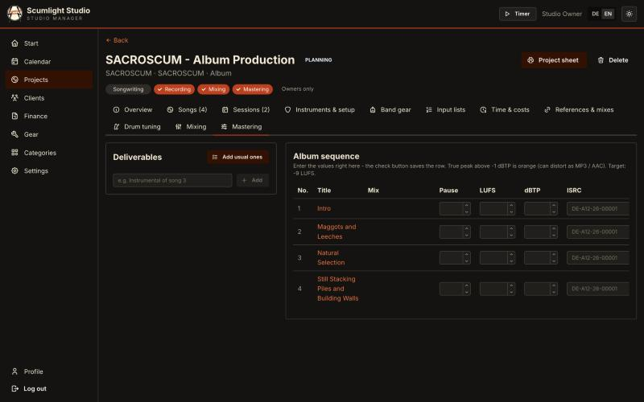

- Deliverables (formats, files to hand over).
- Album list with LUFS, dBTP and ISRC per track.

**Client link** (one private link per project, no login for the band)

- Listen to the mix versions and demos.
- Comment with their name, song and timecode; studio comments show who wrote them.
- Approve a mix, add references, and enter the band gear.
- Everything new from the band appears under "New from clients" on the start page.

## Finance

The finance part replaced a separate invoicing tool (Papierkram): from tracked hours to quote, invoice, payment and the yearly overview for the tax return.

**Time and pricing**

- Default hourly rate; time entries and a start/stop timer; "session done → book the hours".
- Standard tasks such as "Recording / day" = 8 h × hourly rate, used for entries and the timer.
- Price per project: hourly rate or flat price, plus extra items.
- Per project: hours, value, amount invoiced and amount still open.

**Quotes**

- Per project, built from standard tasks, with their own number range, validity and print view.
- Status sent, accepted or declined; an accepted quote becomes an invoice draft with one click.

**Invoices**

- Drafts from open hours and items, grouped by standard task; internal notes stay internal.
- Gap-free invoice numbers and all legally required content; locked once issued, corrections by cancellation invoice.
- Small business (§ 19 UStG) or VAT, payment terms, PDF via print.
- Payments and partial payments, with an overview of open and overdue invoices.

**Expenses and yearly overview**

- Expenses with receipts (PDF or photo), categories and an optional project; a depreciation (AfA) hint for items over 800 € net.
- Yearly overview of income and expenses per month and category, the basis for the EÜR, with CSV export.
- A nightly finance archive per year (CSV lists, invoices, receipts) as a ZIP file.

## Printouts and exports

Every printout is a clean A4 sheet in the studio's design, printed from the browser or saved as a PDF. Nothing has to be retyped for the band or the live room.

| Printout / export | What's on it | Opened from |
| --- | --- | --- |
| Session sheet | Date, engineer, attendees, technical settings, what to do, to-dos to tick, songs, gear to set up (studio and band), drum tuning, room for notes | Session page |
| Input sheet | Every input with source, mic, stand, snake, preamp (in its group color), +48V, HPF, tone, EQ, insert, DAW channel and comment; landscape | Project → Input lists, or the session |
| Project sheet | Project data and technical settings, all songs with BPM, tuning and status, every instrument setup and signal chain, band gear, drum tuning | Project page |
| Session timetable | All sessions in a chosen date range as a day-by-hour grid, with hours per day and a total; for the band | Project page |
| Song sheet | Arrangement, recording checklist, lyrics, references and drum tuning of one song | Song page |
| Songbook | An overview, then every song with arrangement, voice memos and lyrics on its own page | Songwriting tab |
| Quote | Quote with number, items from standard tasks, validity and business data | Finance → Quotes |
| Invoice | Legally complete invoice with gap-free number, VAT or § 19 note, payment terms | Finance → Invoices |
| Yearly overview (CSV) | Every payment received and every expense of a year, for the tax advisor or the EÜR | Finance → Yearly overview |
| Finance archive (ZIP) | Everything of a year in one file: CSV lists, all invoices, all receipts; also created automatically every night | Finance → Yearly overview |
| Calendar feed | All sessions as a live calendar subscription (iCal) for the phone, Nextcloud, Google or Apple calendar | Calendar |

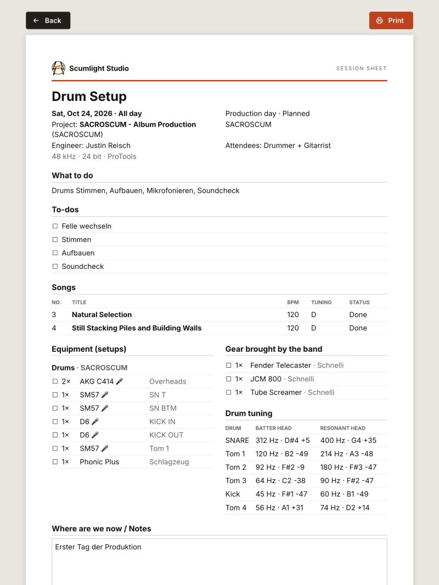

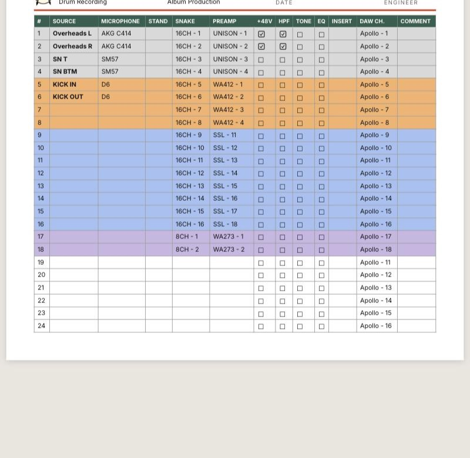

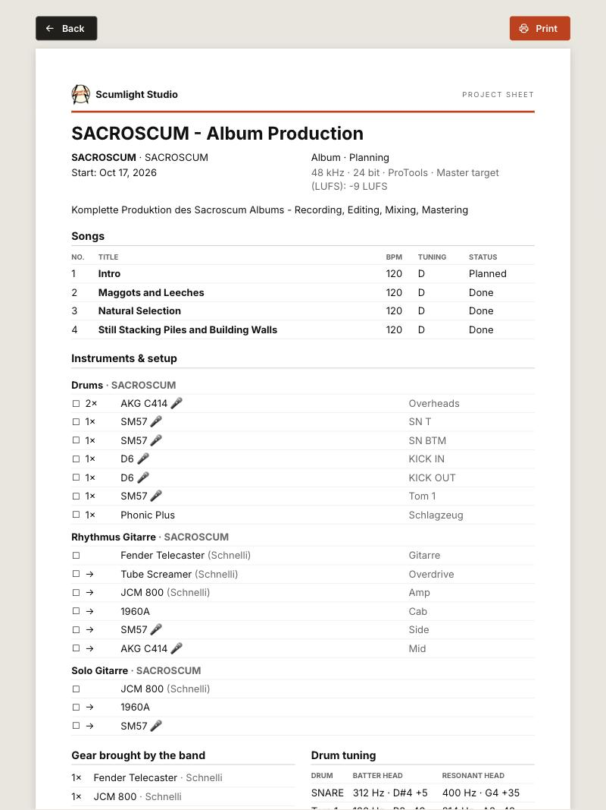

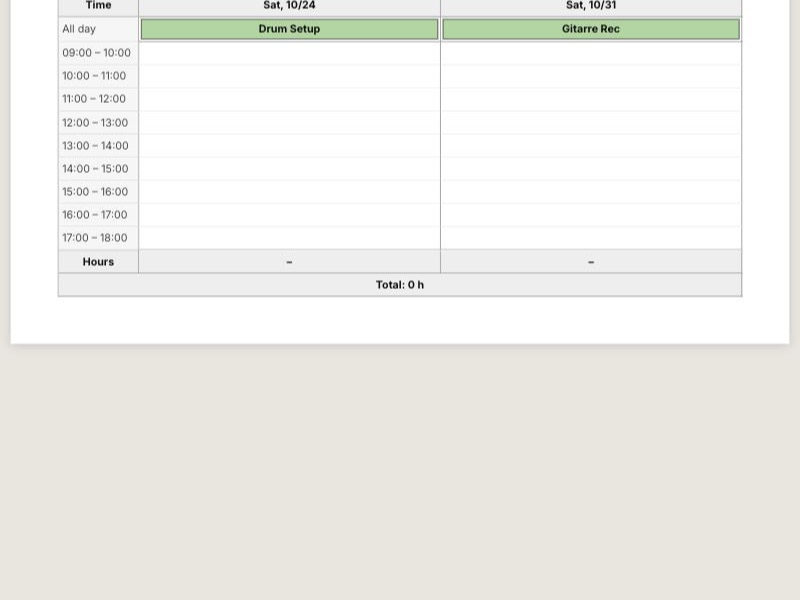

## Team, roles and groups

Several people can work in the same studio data, and each of them sees only what they should.

| | Owner | Assistant |
| --- | --- | --- |
| Projects, songs, sessions, gear | Yes | Yes, only the projects of their groups |
| Finance (hours value, quotes, invoices, expenses) | Yes | No |
| Purchase prices of gear | Yes | No |
| Settings and user logins | Yes | No |

- **Groups:** projects belong to groups. An assistant sees the projects of their groups, projects marked "visible to everyone" and projects they created themselves, including everything that belongs to them (songs, sessions, clients, calendar).
- **Who did what:** clients, projects and sessions show which team member created them, and studio comments on mixes carry the writer's name.
- The rules are enforced on the server, not just hidden in the interface.

## Hosting, security and data safety

The app runs on your own server, so the data never sits with a third-party service.

- **Self-hosted** with Docker (database, app and web server in containers), behind HTTPS, e.g. next to an existing Nextcloud.
- **Login security:** a personal login per user, secure cookies, and a limit on failed login attempts.
- **Backups:** nightly backups of the database and all files, optionally copied off the server, encrypted (rclone). The backup status is shown in the app, with a warning on the start page if something failed.
- **Safe updates:** one script shows what's new, makes a backup, installs the new version and checks that the app responds. A restore script brings a backup back if needed.
- **Data stays when the app grows:** new versions update the database automatically and keep all existing data.

## What's next

The app keeps growing from real studio use. Ideas on the list, roughly in this order:

- Depreciation (AfA) of equipment over its useful life in expenses and the yearly overview
- Recall photos per session or instrument setup (mic positions, amp settings)
- Contacts per client and band, and a global search
- Gear: maintenance log, lending (who has which mic), QR code labels, wishlist and budget
- A Nextcloud folder per project for lyrics, references and contracts
- A waveform player with A/B switching and loudness matching between mix versions
- Patchbay and outboard inserts, reusable input list templates, take and recall sheets
- Lyrics with chords and songwriting splits (GEMA shares)
